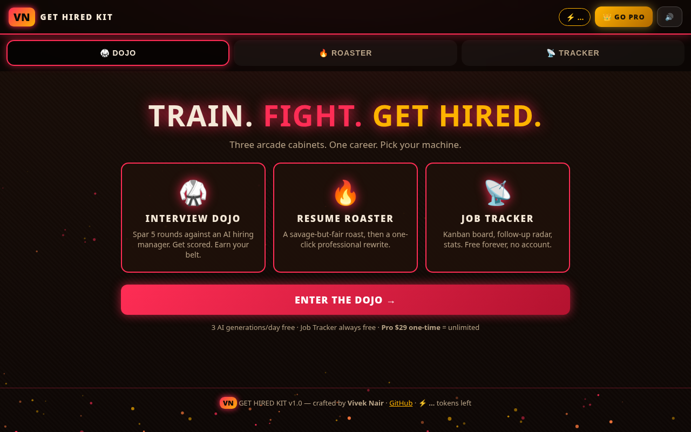
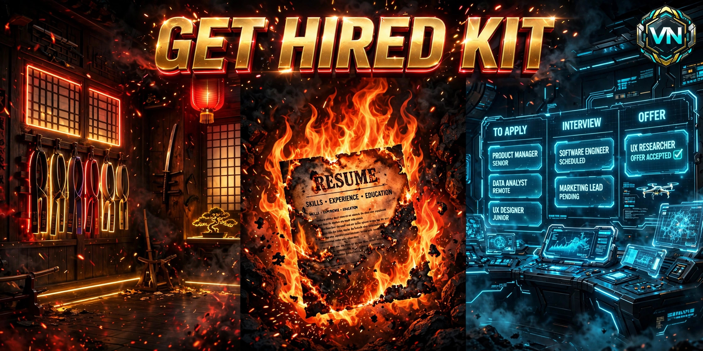

# 🥋 VN Get Hired Kit

**Train. Fight. Get hired.** Three arcade cabinets, one career dojo:

## Screenshot



| Cabinet | What it does |
|---|---|
| 🥋 **Interview Dojo** | Paste a job description → spar 5 rounds against an AI hiring manager → scored feedback + belt rank (White → Black) |
| 🔥 **Resume Roaster** | Savage-but-fair roast of your resume, then a one-click professional rewrite |
| 📡 **Job Tracker** | Kanban board (Applied → Screening → Interview → Offer / Rejected), follow-up radar, stats, JSON backup — free forever, no account |



**Free tier:** 3 AI generations/day · **Pro ($29 one-time):** unlimited. Job Tracker is always free.

Crafted by **Vivek Nair (VN)** — https://github.com/vivekn4

---

## How it actually works (honest edition)

| Claim | Reality |
|---|---|
| "AI interviewer" | Google Gemini (free tier) via its OpenAI-compatible endpoint. You bring your own free key. |
| "Training-dummy mode" | No key / API down → built-in question bank + generic roasts. The app never hard-fails. |
| "3 generations/day" | Soft quota per client (IP + user-agent hash), in-memory, resets daily. One interview = 1 token; roast = 1; rewrite = 1. Answers inside an interview ride free. |
| "Pro license" | Key format `GHK-XXXX-XXXX-XXXX` with checksum. v1 verifies the checksum offline (+ optional Gumroad sale lookup if you set `GUMROAD_ACCESS_TOKEN`). **Tradeoff:** a well-formed key unlocks Pro even without a purchase — the paywall is convenience + goodwill, not DRM. Key sharing is possible in v1. |
| "Your data" | Resumes, JDs, and answers live in server memory only (sessions expire after 30 min) and are **never logged**. The tracker lives in *your* browser's localStorage — we never see it. |

## Quick start (local)

```bash
npm install
cp .env.example .env   # then add your GEMINI_API_KEY (see below)
npm start               # http://localhost:3000
```

### Get a free Gemini key (2 minutes, no card)

1. Go to https://aistudio.google.com/apikey
2. "Create API key" → copy it
3. Put it in `.env` as `GEMINI_API_KEY=...` and restart

Without a key the app runs in training-dummy mode — everything stays clickable.

## Deploy to Render (free)

1. Push this repo to GitHub, then https://dashboard.render.com → New → Web Service → connect the repo
2. Build command: `npm install` · Start command: `npm start`
3. Environment variables (dashboard — **never commit these**):
   - `GEMINI_API_KEY` — your free Gemini key
   - `PRO_SECRET` — long random string (`openssl rand -hex 32`)
   - `GUMROAD_PRODUCT_URL` — your $29 product URL (see below)
   - `GUMROAD_ACCESS_TOKEN` — optional, for verifying keys against real sales
   - `NODE_ENV=production`, `TRUST_PROXY=1`

`render.yaml` in this repo pre-fills the rest.

## Sell Pro on Gumroad ($29 one-time) — setup guide

1. https://gumroad.com → New product → **Digital product**
2. Name: "Get Hired Kit Pro — Unlimited AI Interview Training", price **$29**, one-time payment
3. In the product content, deliver a `license-key.txt` with the customer's key. Generate keys with:
   ```bash
   node -e "import('./lib/license.js').then(m => console.log(m.generateKey()))"
   ```
   (Run once per sale, paste the key into the customer's delivery. A tiny script that emails keys via Gumroad's workflow is the v2 upgrade.)
4. Copy the product's public URL → set as `GUMROAD_PRODUCT_URL` (the app's "BUY PRO" button links there)
5. Optional: Gumroad Settings → Advanced → Applications → generate an access token → set as `GUMROAD_ACCESS_TOKEN` so keys are verified against real purchases

## API

| Method | Route | Notes |
|---|---|---|
| POST | `/api/interview/start` | `{jobDescription, role?}` → session + question 1 |
| POST | `/api/interview/answer` | `{sessionId, answer}` → score + next question / final report |
| POST | `/api/roast` | `{resume}` → roast text |
| POST | `/api/rewrite` | `{resume, jobDescription?}` → rewritten resume |
| POST | `/api/license/verify` | `{key}` → sets HMAC-signed Pro cookie |
| GET | `/api/quota` | `{pro, remaining, daily}` |
| GET | `/api/health` | service status |

## Limits (read before you complain)

- Free tier is **soft** — switching networks resets it. That's intentional; Pro is for people who want to support the work.
- AI answers can be wrong or generic. It's a sparring partner, not a hiring manager.
- The rewrite never invents employers or degrees — but always proofread before sending.
- Render free tier sleeps when idle → first load can take ~30s.

## Dev plan & QC

- Developer plan (architecture, bugs, UI/UX): [`PLAN.md`](PLAN.md)
- Test results: [`QC_NOTES.md`](QC_NOTES.md)
- Asset credits: [`ASSETS.md`](ASSETS.md)

## License

MIT — see [LICENSE](LICENSE). Made loud on purpose. 🔊
